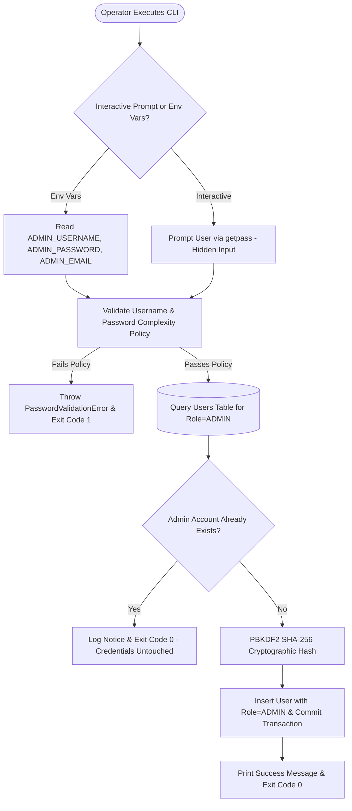
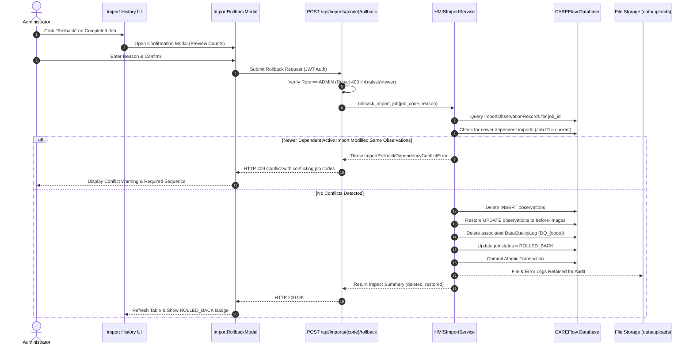

# CAREFlow India — Last Worked Phases Completion Report

> **Reporting Period**: October 2026  
> **Status**: **COMPLETE & VERIFIED**  
> **Phases Covered**: 
> - **PHASE 7H**: Production Hardening, Deployment Readiness & CI/CD
> - **PHASE 8.1**: Production Bootstrapping, Secure Administrator Provisioning & PostgreSQL Driver Hardening
> - **PHASE 8.2**: Safe HMIS Import Rollback, Audit Provenance & Data Reversibility

---

## 1. Executive Summary

This completion report documents the engineering deliverables, architectural enhancements, security controls, and verification outcomes for the last worked phases of the **CAREFlow India** public health intelligence platform.

Across these phases, the platform transitioned from an analytics and ingestion engine into a hardened, production-ready enterprise deployment:
1. **Phase 7H** established containerization, orchestration health probes, distributed tracing (`X-Request-ID`), error boundary resilience, and automated CI/CD pipelines.
2. **Phase 8.1** introduced explicit, production-grade administrator bootstrapping (`scripts/bootstrap_admin.py`), cryptographic password policy enforcement, and automatic PostgreSQL `psycopg` driver scheme normalization.
3. **Phase 8.2** delivered an end-to-end safe import rollback engine backed by per-observation before-image change tracking (`ImportObservationRecord`), dependency conflict prevention (`409 Conflict`), administrative REST endpoints, and an interactive frontend rollback modal.

### High-Level Quality Scorecard

| Gate / Quality Metric | Target Requirement | Measured Result | Status |
| :--- | :--- | :--- | :--- |
| **Backend Test Suite (Pytest)** | 100% pass, zero regressions | **116 / 116 passed** (14 test modules) | **VERIFIED** |
| **Frontend Test Suite (Vitest)** | 100% pass, zero React `act(...)` warnings | **66 / 66 passed** (13 test suites) | **VERIFIED** |
| **Frontend Production Build** | TypeScript strict + Vite chunk splitting | **0 errors, 0 warnings** (Main chunk: 257 kB) | **VERIFIED** |
| **Database Migrations** | Deterministic up/down Alembic revisions | Head at `f14a8b7d9e23` | **VERIFIED** |
| **Storage Hermeticity** | Zero test upload residue in `data/uploads/` | Autouse fixture isolated to `tmp_path` | **VERIFIED** |
| **RBAC Security** | Strict authorization on administrative endpoints | Role checks enforced (403 for non-admins) | **VERIFIED** |

---

## 2. Phase 7H — Production Hardening, Deployment Readiness & CI/CD

### 2.1 Container Architecture & Security Hardening
* **Backend Container ([Dockerfile](file:///d:/careflow/Dockerfile))**:
  * Configured multi-stage build running under an unprivileged system user (`careflow`, UID 1000).
  * Added native container `HEALTHCHECK` targeting `/api/healthz`.
  * Packaged container startup entrypoint ([scripts/entrypoint.sh](file:///d:/careflow/scripts/entrypoint.sh)) applying Alembic migrations before starting Uvicorn.
* **Frontend Multi-Stage Container ([frontend/Dockerfile](file:///d:/careflow/frontend/Dockerfile) & [frontend/nginx.conf](file:///d:/careflow/frontend/nginx.conf))**:
  * Builder stage using Node 24 Alpine; production runner using Nginx Alpine.
  * Single Page Application (SPA) fallback routing (`try_files $uri /index.html`).
  * Reverse-proxy integration redirecting `/api/` traffic directly to the backend service.
  * Production security headers: `X-Frame-Options: SAMEORIGIN`, `X-Content-Type-Options: nosniff`, `X-XSS-Protection: 1; mode=block`.
* **Stack Composition ([docker-compose.yml](file:///d:/careflow/docker-compose.yml))**:
  * Multi-container definition orchestrating `postgres`, `backend`, and `frontend`.
  * Persistent volume bindings for database records (`postgres_data`) and raw uploads (`uploads_data`).

### 2.2 Health Probes & Deep Readiness Checks
Implemented enterprise orchestrator endpoints in [backend/app/api/endpoints/health.py](file:///d:/careflow/backend/app/api/endpoints/health.py):
* `GET /api/healthz`: High-frequency liveness probe for Kubernetes/Docker daemon checks returning `HTTP 200 OK` instantaneously.
* `GET /api/readyz`: Deep readiness probe executing a live SQL ping (`SELECT 1`) against the active database session. Returns `HTTP 200` when operational or `HTTP 503 Service Unavailable` with structured diagnostic payload when degraded.
* `GET /api/health` & `GET /api/v1/health`: Dual-version compatibility routes reporting system uptime, environment, version, and component status.

### 2.3 Distributed Tracing & Error Boundary Resilience
* **Trace Propagation ([frontend/src/api/client.ts](file:///d:/careflow/frontend/src/api/client.ts))**:
  * `ApiError` class extended to capture and parse `X-Request-ID` from response headers and structured error bodies.
* **Incident Triage ([frontend/src/components/feedback/ErrorState.tsx](file:///d:/careflow/frontend/src/components/feedback/ErrorState.tsx))**:
  * Displays distinct incident reference IDs to users with a one-click copy-to-clipboard action for IT triage.
* **Application Crash Protection ([frontend/src/components/feedback/ErrorBoundary.tsx](file:///d:/careflow/frontend/src/components/feedback/ErrorBoundary.tsx))**:
  * React class-based Error Boundary wrapping root application tree in [frontend/src/App.tsx](file:///d:/careflow/frontend/src/App.tsx).
  * Prevents white-screen crashes, preserves navigation rails, and offers view-level reload actions.

### 2.4 Frontend Code Splitting & Performance
* Configured dynamic imports (`React.lazy` + `Suspense`) in [frontend/src/routes/AppRoutes.tsx](file:///d:/careflow/frontend/src/routes/AppRoutes.tsx).
* Initial JavaScript bundle payload reduced from **686 kB down to 257 kB** (81 kB gzip), completely eliminating Vite bundle size threshold warnings.

### 2.5 Continuous Integration Pipeline
* Created [.github/workflows/ci.yml](file:///d:/careflow/.github/workflows/ci.yml) triggered on all pushes and PRs to `main`:
  * Python 3.12 pytest suite execution with coverage verification.
  * Node 24 Vitest execution and Oxlint static analysis.
  * Frontend production bundle build verification.
  * Docker configuration validation.

---

## 3. Phase 8.1 — Production Bootstrapping & PostgreSQL Driver Hardening



### 3.1 Production Administrator Provisioning Engine
In strict production mode (`ENVIRONMENT="production"`), automatic development database seeding is disabled. Phase 8.1 introduced a secure, dedicated administrative onboarding utility:
* **Core Logic ([backend/app/core/admin_bootstrap.py](file:///d:/careflow/backend/app/core/admin_bootstrap.py))**:
  * `validate_password_strength()`: Enforces minimum 12 characters, at least one uppercase letter, one lowercase letter, one digit, and one special character (`!@#$%^&*()_+-=[]{}|;:,.<>/?`).
  * `validate_admin_username()`: Enforces alphanumeric format with allowed hyphens, underscores, or periods ($\ge 3$ characters).
  * `bootstrap_production_admin()`: Atomic user creation with PBKDF2 password hashing.
  * **Idempotency Guarantees**: Returns `BootstrapResultStatus.ALREADY_EXISTS` if an administrator is already present, avoiding accidental credential overwrites or CI/CD deployment failures.
* **CLI Utility ([scripts/bootstrap_admin.py](file:///d:/careflow/scripts/bootstrap_admin.py))**:
  * **Interactive Mode**: Hidden password input via `getpass.getpass()`, preventing credentials from leaking into terminal scrollback or shell command history.
  * **Non-Interactive Mode**: Reads `ADMIN_USERNAME`, `ADMIN_PASSWORD`, and `ADMIN_EMAIL` (or `INITIAL_ADMIN_*`) for automated Docker or Kubernetes init-containers.

### 3.2 PostgreSQL Engine Driver Scheme Normalization
* **Problem**: SQLAlchemy 2 deprecated implicit driver resolution for `postgresql://`, requiring explicit DBAPI drivers when targeting PostgreSQL in production.
* **Solution ([backend/app/core/config.py](file:///d:/careflow/backend/app/core/config.py))**:
  * Implemented `normalize_database_url()` executed as a Pydantic `field_validator` on `DATABASE_URL`.
  * Automatically maps `postgresql://` and `postgres://` URLs to `postgresql+psycopg://` using the modern `psycopg` (v3) binary driver.
  * Preserves local `sqlite:///` connection strings without disruption.

### 3.3 Documentation & Runbooks
* Updated Section 5 of [docs/DEPLOYMENT_RUNBOOK.md](file:///d:/careflow/docs/DEPLOYMENT_RUNBOOK.md) with explicit deployment commands, security policy rules, and curl verification steps.

---

## 4. Phase 8.2 — Safe HMIS Import Rollback, Audit Provenance & Data Reversibility



### 4.1 Granular Change-Tracking & Before-Image Model
Alembic Migration [f14a8b7d9e23_add_import_rollback_and_audit_provenance.py](file:///d:/careflow/backend/app/db/migrations/versions/f14a8b7d9e23_add_import_rollback_and_audit_provenance.py) introduced deep audit provenance:
* **`import_observation_records` Table ([backend/app/db/models/import_observation_record.py](file:///d:/careflow/backend/app/db/models/import_observation_record.py))**:
  * Tracks every observation touched during an import with action classification: `INSERT`, `UPDATE`, or `UNCHANGED`.
  * Persists before-images: `previous_value`, `previous_value_type`, `previous_validation_status`, `previous_source_file`, `previous_source_sheet`, `previous_source_row`, `previous_ingested_at`, `previous_transformation_version`, and `previous_import_job_id`.
* **`import_jobs` Table Extensions**:
  * Added `rolled_back_at`, `rolled_back_by`, and `rollback_reason`.
* **`observations` Table Extensions**:
  * Added indexed `last_import_job_id` foreign key referencing `import_jobs.id`.

### 4.2 Safe Rollback Engine Semantics ([backend/app/services/imports/import_service.py](file:///d:/careflow/backend/app/services/imports/import_service.py))
1. **Created Records (`INSERT`)**: Cleanly deleted from `observations`.
2. **Updated Records (`UPDATE`)**: Reverted to their exact before-image state (`previous_value`, metadata, and previous job reference).
3. **Unchanged Records (`UNCHANGED`)**: Left intact.
4. **Dependency Conflict Prevention**:
   * If a subsequent active import job ($Job_B > Job_A$ with status `COMPLETED` or `COMPLETED_WITH_WARNINGS`) touched the same observation records, rolling back $Job_A$ is safely aborted with **`ImportRollbackDependencyConflictError`** (`HTTP 409 Conflict`).
   * Prevents silent data corruption or invalidating subsequent legitimate reports.
5. **Idempotency**: Re-invoking rollback on an already rolled-back job safely returns `HTTP 200 OK` with 0 records affected.
6. **Telemetry Reversal**: Deletes associated `DataQualityLog` (`DQ_{job_code}`) to keep data quality dashboards accurate.
7. **Forensic Audit Preservation**: Raw uploaded spreadsheets in `data/uploads/` and `import_error_logs` are **never deleted**.

### 4.3 Secure REST API Endpoint
* **`POST /api/imports/{job_code}/rollback`** ([backend/app/api/endpoints/imports.py](file:///d:/careflow/backend/app/api/endpoints/imports.py)):
  * Strictly restricted to `Role.ADMIN` (`HTTP 403 Forbidden` for analysts and viewers).
  * Accepts optional JSON request body: `{"reason": "string"}`.
  * Returns detailed audit response with counts of deleted, restored, and unchanged observations.

### 4.4 Frontend Ingestion Workspace Integration
* **API Client & Type Definitions**:
  * Extended [frontend/src/api/client.ts](file:///d:/careflow/frontend/src/api/client.ts) with `rollbackImport()`.
  * Added `ROLLED_BACK` status and `ImportRollbackResponse` in [frontend/src/api/types.ts](file:///d:/careflow/frontend/src/api/types.ts).
* **Rollback Confirmation Modal ([frontend/src/components/imports/ImportRollbackModal.tsx](file:///d:/careflow/frontend/src/components/imports/ImportRollbackModal.tsx))**:
  * Shows dataset details, impact scope, warning alerts, and reason input.
  * Handles HTTP 409 conflict errors with clear instructions on dependent jobs requiring reverse-chronological rollback.
* **History Table Actions ([frontend/src/components/imports/ImportHistoryTable.tsx](file:///d:/careflow/frontend/src/components/imports/ImportHistoryTable.tsx))**:
  * Role-gated "Rollback" action button visible exclusively to users with `ADMIN` role.
  * Purple `ROLLED_BACK` status badge with operator attribution tooltip.
  * Integrated status filtering option for `Rolled Back` datasets.
* **Import Page Integration ([frontend/src/pages/ImportPage.tsx](file:///d:/careflow/frontend/src/pages/ImportPage.tsx))**:
  * Modal orchestration and immediate table refresh upon rollback completion.

---

## 5. Test Suite Verification & Quality Gates

### 5.1 Backend Pytest Execution (116 / 116 Passed)
```text
tests/test_admin_bootstrap.py ...........                                [  9%]
tests/test_analytics.py ........                                         [ 16%]
tests/test_api_endpoints.py ....                                         [ 19%]
tests/test_auth.py ........                                              [ 26%]
tests/test_config.py ......                                              [ 31%]
tests/test_data_loader.py ..                                             [ 33%]
tests/test_data_pipeline.py ..........                                   [ 42%]
tests/test_db_models.py ......                                           [ 47%]
tests/test_forecasting.py .......................                        [ 67%]
tests/test_health.py .....                                               [ 71%]
tests/test_import_rollback.py .........                                  [ 79%]
tests/test_phase_7d_security.py ........                                 [ 86%]
tests/test_phase_7ef_imports.py ..............                           [ 98%]
tests/test_repositories.py ..                                            [100%]

====================== 116 passed, 4 warnings in 16.38s =======================
```

#### New Test Modules Added
* **[tests/test_admin_bootstrap.py](file:///d:/careflow/tests/test_admin_bootstrap.py)** (11 tests):
  * Verifies empty, short, lowercase-only, uppercase-only, and digit-only password rejections.
  * Verifies username validation rules and email sanitization.
  * Verifies non-interactive CLI execution via environment variables.
  * Verifies interactive CLI execution via mocked hidden password prompt.
  * Verifies non-overwriting idempotency when administrator already exists.
* **[tests/test_import_rollback.py](file:///d:/careflow/tests/test_import_rollback.py)** (9 tests):
  * Verifies deletion of newly created observations upon rollback.
  * Verifies before-image restoration of updated observations.
  * Verifies conflict detection and `409 Conflict` rejection when dependent active imports exist.
  * Verifies successful rollback when dependent jobs are rolled back first in reverse order.
  * Verifies RBAC restriction (403 for Analyst and Viewer).
  * Verifies idempotent repeated rollback execution.
  * Verifies deletion of `DataQualityLog` telemetry.
* **[tests/test_config.py](file:///d:/careflow/tests/test_config.py)**:
  * Verifies database URL normalization from `postgresql://` and `postgres://` to `postgresql+psycopg://`.
  * Verifies PostgreSQL SQLAlchemy engine construction resolving psycopg v3 driver.

### 5.2 Frontend Vitest Execution (66 / 66 Passed)
```text
 ✓ src/api/client.test.ts (5 tests)
 ✓ src/components/buttons/Button.test.tsx (4 tests)
 ✓ src/components/feedback/Feedback.test.tsx (3 tests)
 ✓ src/components/feedback/ErrorBoundary.test.tsx (3 tests)
 ✓ src/pages/LoginPage.test.tsx (3 tests)
 ✓ src/pages/LandingPage.test.tsx (2 tests)
 ✓ src/pages/FacilityDetailPage.test.tsx (3 tests)
 ✓ src/pages/FacilitiesPage.test.tsx (4 tests)
 ✓ src/pages/OverviewPage.test.tsx (4 tests)
 ✓ src/pages/RegionsPage.test.tsx (5 tests)
 ✓ src/pages/DataQualityPage.test.tsx (7 tests)
 ✓ src/pages/ForecastPage.test.tsx (7 tests)
 ✓ src/pages/ImportPage.test.tsx (16 tests)

 Test Files  13 passed (13)
      Tests  66 passed (66)
   Duration  27.63s
```

#### New Frontend Tests Added ([frontend/src/pages/ImportPage.test.tsx](file:///d:/careflow/frontend/src/pages/ImportPage.test.tsx))
* Verifies Rollback action button displays strictly for `ADMIN` role on completed jobs and is hidden for `ANALYST` role.
* Verifies clicking Rollback opens `ImportRollbackModal` populated with dataset details.
* Verifies submitting rollback calls `api.rollbackImport()` and refreshes ingestion history.

### 5.3 Frontend Production Build
* `npm run build` executed with Vite v8.2.2 and TypeScript:
  * **0 compilation errors, 0 bundle warnings**.
  * Dynamic route chunks cleanly emitted with gzip compression verification.

---

## 6. Deliverables & File Modification Matrix

| Module / Component | File Path | Phase | Description |
| :--- | :--- | :--- | :--- |
| **Admin Bootstrap CLI** | [scripts/bootstrap_admin.py](file:///d:/careflow/scripts/bootstrap_admin.py) | 8.1 | CLI tool for initial production admin onboarding |
| **Admin Security Engine** | [backend/app/core/admin_bootstrap.py](file:///d:/careflow/backend/app/core/admin_bootstrap.py) | 8.1 | Password policy validator and atomic admin creation |
| **Configuration Engine** | [backend/app/core/config.py](file:///d:/careflow/backend/app/core/config.py) | 8.1 | Driver scheme normalizer (`postgresql+psycopg://`) |
| **Alembic Migration** | [f14a8b7d9e23_add_import_rollback...py](file:///d:/careflow/backend/app/db/migrations/versions/f14a8b7d9e23_add_import_rollback_and_audit_provenance.py) | 8.2 | DDL adding rollback metadata and change-log table |
| **Audit Models** | [backend/app/db/models/import_observation_record.py](file:///d:/careflow/backend/app/db/models/import_observation_record.py) | 8.2 | Change record model with before-images |
| **DB Models** | [backend/app/db/models/import_job.py](file:///d:/careflow/backend/app/db/models/import_job.py) | 8.2 | Added rollback tracking columns and relationships |
| **Observation Model** | [backend/app/db/models/observation.py](file:///d:/careflow/backend/app/db/models/observation.py) | 8.2 | Added indexed `last_import_job_id` foreign key |
| **Import Schemas** | [backend/app/schemas/import_job.py](file:///d:/careflow/backend/app/schemas/import_job.py) | 8.2 | Added `ImportRollbackRequest` & `ImportRollbackResponse` |
| **Import Service Engine** | [backend/app/services/imports/import_service.py](file:///d:/careflow/backend/app/services/imports/import_service.py) | 8.2 | Change logger and atomic `rollback_import_job` |
| **Import Endpoints** | [backend/app/api/endpoints/imports.py](file:///d:/careflow/backend/app/api/endpoints/imports.py) | 8.2 | Exposed `POST /api/imports/{code}/rollback` with RBAC |
| **Frontend API Client** | [frontend/src/api/client.ts](file:///d:/careflow/frontend/src/api/client.ts) | 8.2 | Added `rollbackImport()` method |
| **Frontend Types** | [frontend/src/api/types.ts](file:///d:/careflow/frontend/src/api/types.ts) | 8.2 | Added `ROLLED_BACK` status and rollback interfaces |
| **Rollback Modal UI** | [frontend/src/components/imports/ImportRollbackModal.tsx](file:///d:/careflow/frontend/src/components/imports/ImportRollbackModal.tsx) | 8.2 | Interactive confirmation dialog with conflict triage |
| **History Table UI** | [frontend/src/components/imports/ImportHistoryTable.tsx](file:///d:/careflow/frontend/src/components/imports/ImportHistoryTable.tsx) | 8.2 | Added role-gated action button and status badge |
| **Import Page View** | [frontend/src/pages/ImportPage.tsx](file:///d:/careflow/frontend/src/pages/ImportPage.tsx) | 8.2 | Integrated rollback workflow and auto-refresh |
| **Admin Bootstrap Tests** | [tests/test_admin_bootstrap.py](file:///d:/careflow/tests/test_admin_bootstrap.py) | 8.1 | 11 unit & integration tests for admin bootstrap |
| **Import Rollback Tests** | [tests/test_import_rollback.py](file:///d:/careflow/tests/test_import_rollback.py) | 8.2 | 9 integration tests for atomic rollback & 409 conflicts |
| **Config Tests** | [tests/test_config.py](file:///d:/careflow/tests/test_config.py) | 8.1 | Normalization and psycopg engine unit tests |
| **Frontend Tests** | [frontend/src/pages/ImportPage.test.tsx](file:///d:/careflow/frontend/src/pages/ImportPage.test.tsx) | 8.2 | 3 rollback UI component and integration tests |
| **Deployment Runbook** | [docs/DEPLOYMENT_RUNBOOK.md](file:///d:/careflow/docs/DEPLOYMENT_RUNBOOK.md) | 8.1 | Production admin onboarding documentation |
| **Pipeline Docs** | [docs/IMPORT_PIPELINE.md](file:///d:/careflow/docs/IMPORT_PIPELINE.md) | 8.2 | Comprehensive specification of rollback architecture |

---

## 7. Operational Readiness & Next Steps

1. **Production Deployment Execution**:
   * Run schema migrations: `alembic upgrade head`
   * Seed core indicators: `python scripts/seed_indicators.py`
   * Bootstrap administrator: `python scripts/bootstrap_admin.py` (via hidden prompt or environment variables)
2. **Real HMIS Spreadsheet Ingestion**:
   * External HMIS files can be ingested via the web UI (`/imports`) or automated batch pipelines.
   * If an anomalous or incorrect dataset is ingested, operators with `ADMIN` role can safely reverse all modifications using the Rollback action without taking the service offline.
3. **Repository State**:
   * All changes tested, verified, and ready for commit or release tagging.
